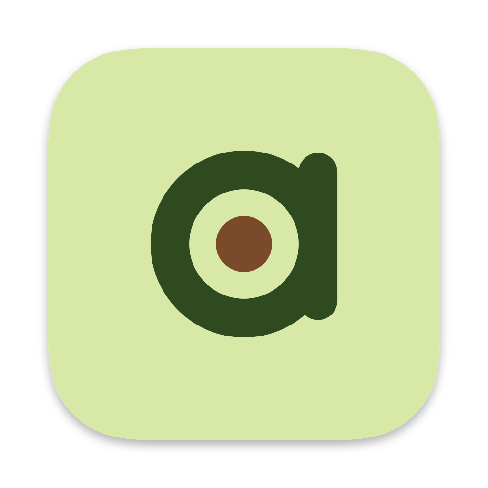
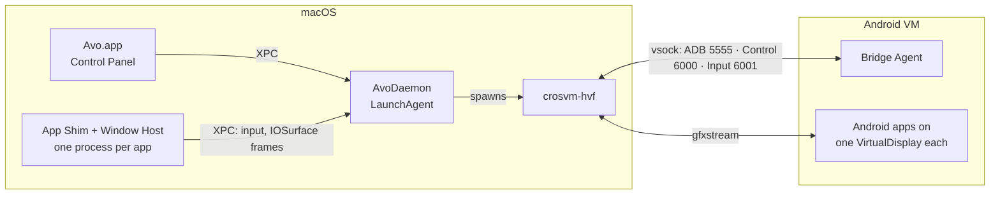

<p align="center">
  
</p>

<h1 align="center">Avo</h1>

<p align="center">Android apps on macOS, each in its own window.<br>
Open source, for Apple Silicon.</p>

---

Avo runs Android in a lightweight VM in the background and shows every Android
app as a normal Mac app: its own window, its own Dock icon, Launchpad and
Spotlight entries, Cmd+Tab, notifications in Notification Center, a shared
clipboard and drag and drop from Finder. Games get keyboard, mouse and gamepad
controls through keymap profiles, including an FPS mode with mouse-look.

The full technical specification (Indonesian) is in [docs/spec.md](docs/spec.md).

## Status

Avo is in **Phase 1 (Foundation)** of the [roadmap](docs/spec.md#roadmap-mvp).
The macOS host is built and tested against a simulated guest; the VM engine
and the Android image are not done yet, so **Avo cannot run Android apps yet**.

| Component | Where | State |
| --- | --- | --- |
| Control Panel (SwiftUI): app grid, install sheet, settings tabs | `host/Avo` | Working; tested with the daemon |
| Runtime Daemon (LaunchAgent) + menu bar item | `host/AvoDaemon`, `host/AvoKit/Sources/AvoDaemonCore` | Working up to "start VM" (needs engine and image) |
| App Shims + Window Host (one Mac window per Android display) | `host/AvoShim`, `host/AvoWindowHost` | Working; frames need the engine |
| Package installer (.apk, .xapk, .apkm, .apks, OBB) | `AvoPackages`, `InstallPipeline` | Working against a simulated adbd |
| ADB client (auth, shell v2, exec, sync, pm sessions) | `AvoADB` | Working; key format checked against `adb` |
| Keymapping engine, FPS mode, editor overlay | `AvoKeymap`, `host/AvoWindowHost` | Working in tests; editor is basic |
| Host ↔ guest protocol (Control protobuf, Input records) | `proto/`, `AvoProtocol` | Version 1, cross-checked Swift ↔ Java |
| Bridge Agent (Android system app) | `guest/bridge-agent` | Compiles (SDK + NDK); not run on a device yet |
| Avo AOSP product (device tree, sepolicy, avo_init) | `guest/device/avo` | Skeleton; needs an AOSP 16 build |
| Engine VM: crosvm with a Hypervisor.framework backend | `engine/` | HVF backend crate boots the Android 16 kernel to `init`; crosvm port not started ([engine.md](docs/engine.md)) |

## Repository

```
branding/            Logo ("Monogram a"), app icon sources, generator
docs/                Spec, architecture, protocol, engine plan, brand
proto/               Host <-> guest protocol (protobuf) and test vectors
host/                macOS: Xcode project (XcodeGen) and the AvoKit Swift package
  Avo/               Control Panel app
  AvoDaemon/         Runtime Daemon + menu bar item (LaunchAgent)
  AvoWindowHost/     Window Host framework, loaded by every App Shim
  AvoShim/           App Shim template
  avoctl/            Command-line control of the daemon
  AvoKit/            Core logic and tests (swift test)
guest/               Android: Bridge Agent and the Avo AOSP product
engine/              VM engine: HVF backend crates (Rust) and the crosvm port plan
profiles/            Device profiles and community keymap profiles (JSON)
scripts/             Code generation and image packaging
```

## Building

Requirements: a Mac with Apple Silicon, macOS 15 or later, Xcode 26 or later,
and [XcodeGen](https://github.com/yonaskolb/XcodeGen).

```sh
make test       # 126 unit and integration tests of the host core (swift test)
make project    # generate host/Avo.xcodeproj
make build      # build Avo.app with xcodebuild
make agent      # build the Bridge Agent APK (Android SDK + NDK)
```

Or open `host/Avo.xcodeproj` in Xcode and run the **Avo** scheme. The first
launch registers the Runtime Daemon as a LaunchAgent; macOS may ask you to
allow it in System Settings › General › Login Items.

`avoctl` (inside `Avo.app/Contents/MacOS`) drives the daemon from a terminal:

```sh
avoctl status
avoctl install ~/Downloads/F-Droid.apk
avoctl config fpsLimit=120 memoryMiB=8192
```

## How it fits together



Details: [architecture](docs/architecture.md), [protocol](docs/protocol.md),
[engine](docs/engine.md), [brand](docs/brand.md).

## What Avo will not do

Avo does not bundle Google Play or Google apps (you can use F-Droid or Aurora
Store, microG, or install a GApps package you downloaded yourself). Banking,
e-wallet and DRM apps that rely on hardware attestation are not expected to
work. Keymaps never include recoil macros, auto-aim or automatic rapid fire,
and Avo does not hide itself from anti-cheat systems.

## License

Apache License 2.0 for the host, the Bridge Agent and the device
configuration ([LICENSE](LICENSE)). crosvm is BSD-3-Clause. GPL components (the
Linux kernel and KernelSU) are built and published separately. Android is a
trademark of Google LLC; device names in `profiles/devices` are used only for
app compatibility.
